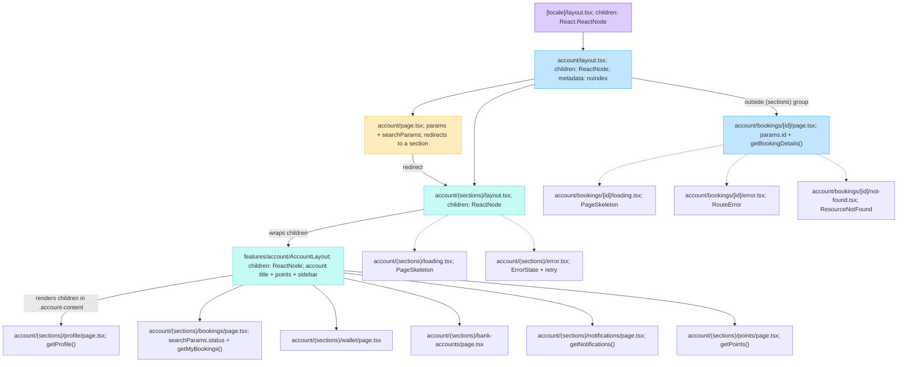

# Account routes and layout composition

This diagram reflects the current App Router structure under
`src/app/[locale]/account`. The route group `(sections)` does not appear in the
URL; it exists to share the account shell between the section pages.

## Children composition

| Layer | `children` behavior |
| --- | --- |
| `src/app/[locale]/layout.tsx` | Receives the locale route tree and renders it inside the site shell, including `<main>{children}</main>`. |
| `src/app/[locale]/account/layout.tsx` | Receives the account route tree and returns `{children}` unchanged. Its role is metadata (`noindex`), not visual layout. |
| `src/app/[locale]/account/(sections)/layout.tsx` | Receives a section page and passes it to `<AccountLayout>{children}</AccountLayout>`. |
| `src/features/account/components/AccountLayout.tsx` | Receives the section page as `children` and renders it inside `.account-content`, alongside the account title, points summary, and `AccountNav`. |
| `src/app/[locale]/account/bookings/[id]/page.tsx` | Is outside `(sections)`, so it receives the account passthrough and does not render the sidebar/title shell. It keeps a full-width booking-details layout. |

## Route notes

- `/account` redirects to `/account/profile`, while legacy `/account?tab=...` values are mapped to their section route.
- The primary account navigation links to `profile`, `bookings`, `wallet`, `bank-accounts`, and `notifications`.
- `points/page.tsx` exists as an account section route but is not one of the five primary navigation tabs.
- `/account/bookings/[id]` has its own loading, error, and not-found boundaries.
- Section routes share the `(sections)/loading.tsx` and `(sections)/error.tsx` boundaries; the account shell remains available while the section content loads or fails.
